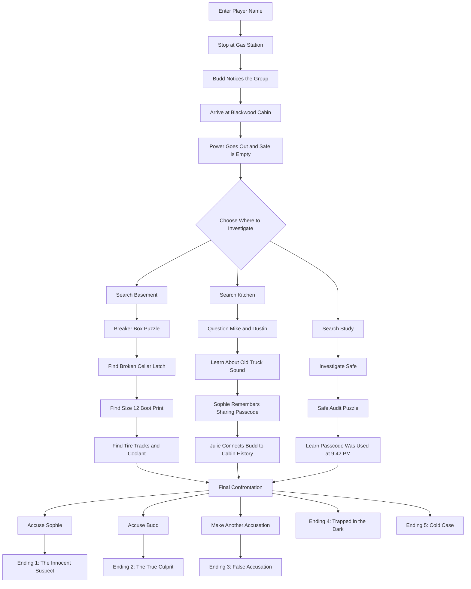

# WEB-115 Final Project

## Team Members and Roles

### Ricardo
- Responsibilities: UI structure, styling, and story interface framework

### Sarina
- Responsibilities: Created an interactive mystery game with css and js file

### Shiva
- Responsibilities: Weekly meeting agendas, added second story "The mysterious seventh at the Blackwood Cabin". This will modify the current Ending 2 - The Unseen Intruder (Twist Ending) to Ending 2 - The Mysterious Seventh (True Culprit), provide final CSS component 

## Application Overview

[The main story]
To celebrate graduating and mark one last getaway before everyone moves away to start their new jobs and adult lives, six of closest college friends rent a remote mountain cabin for the weekend. As the group realizes about the upcoming winter storm, they pay a visit to the gas-station to purchase last minute supplies. Budd Lynn, the local gas attendant, lived few miles off of the Blackwood cabin. His grand father used to own the property back in the day. Growing up, he often visited the cabins with his grandpa so he knew the ins and outs of that place. He learnt that they were staying at the Blackwood cabins while striking a quick conversation with Julie. 

Back at the cabin, everyone get settled in—and before dinner, all friends lock their watches, emergency cash, and graduation gifts inside the cabin's heavy wall safe for safekeeping. Later that night, a sudden blizzard knocks out the power, and when the backup lights flicker on, the safe door is standing wide open and completely empty. With the mountain roads snowed in until dawn, you will take the lead to search the cabin, uncover hidden motives, and determine whether one of the friends betrayed the group or if an intruder slipped inside undetected.

## Game play overview

* Character Customization (Text Input): At the very start of the game, players type in their own name for the main    character, which is dynamically used throughout the story and suspect dialogue.
* Room Exploration (Button/Menu Choices): Choose which areas of the cabin to search (The Study, The Kitchen, The Basement, or The Mudroom). Each room reveals clues pointing toward either an inside job or an outside intruder.
* The Breaker Box Puzzle (Text Input): In the basement, players find a jammed fuse panel with a scratched riddle on the metal door. Entering the correct 4-letter password restores power to the cabin's smart-lock and security sensor log.
* The Safe Override & Audit Log (Text Input): Players piece together a torn rental manual and receipt to enter a 4-digit diagnostic code into the electronic safe keypad, revealing whether the safe was opened with the passcode or bypassed.
* The Final Accusation (Text Input): To trigger the finale, players must type who is responsible (a specific friend's name or "Stranger") along with the key piece of evidence proving their theory.

## Controls and Navigation

- Use the choice buttons to make story decisions.
- Use the text input when a scene requires an answer.
- Keyboard controls may be used during certain scenes.
- Inventory and score update as the player progresses.

## Story Flowchart

## Technical Features

- Branching story choices
- Dynamic story text
- Changing story images
- Inventory system
- Score tracking
- Journal/log system
- Text input and validation
- Keyboard controls
- Hover hints
- JSON save/load
- Cookies
- Error handling
- Timers and delayed events

## Git Workflow

Each team member works on their own branch and submits changes to `main` through pull requests.

## Testing Notes

[Add testing notes here as the project develops.]