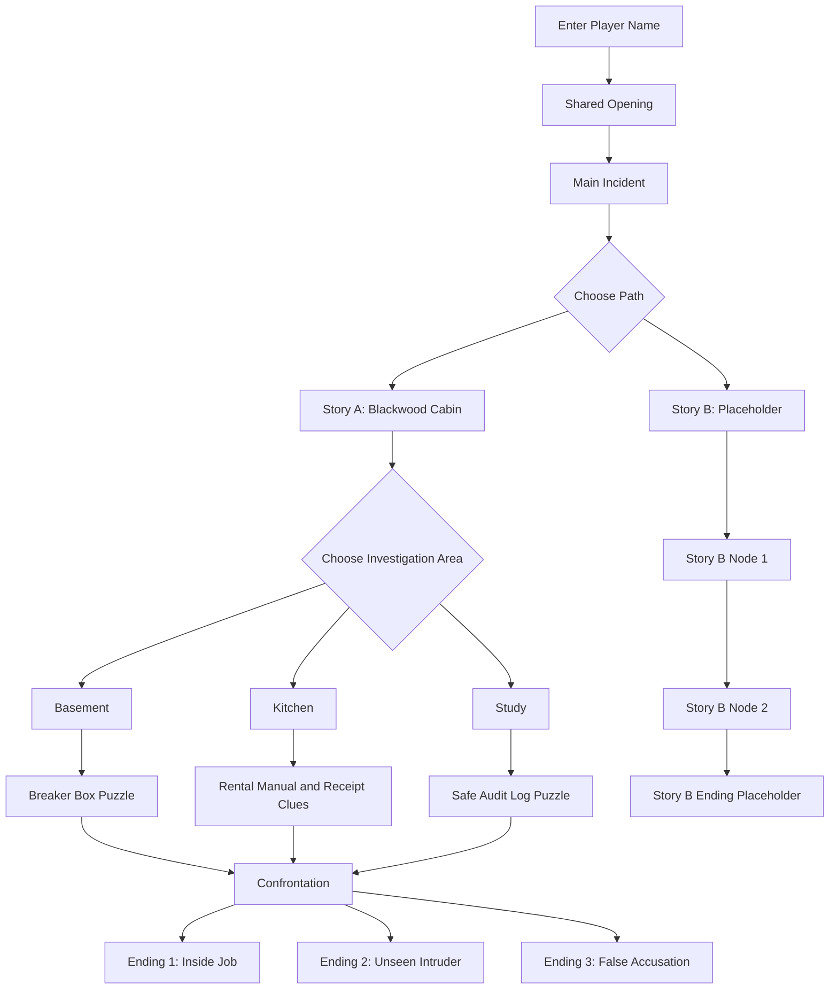

# WEB-115 Final Project

## Team Members and Roles

### Ricardo
- Responsibilities: UI structure, styling, and story interface framework

### Sarina
- Responsibilities:

### Shiva
- Responsibilities:

## Application Overview

[Write story/gameplay overview here.]

## Controls and Navigation

- Use the choice buttons to make story decisions.
- Use the text input when a scene requires an answer.
- Keyboard controls may be used during certain scenes.
- Inventory and score update as the player progresses.

## Story Flowchart

## Technical Features

- Branching story choices
- Dynamic story text
- Changing story images
- Inventory system
- Score tracking
- Journal/log system
- Text input and validation
- Keyboard controls
- Hover hints
- JSON save/load
- Cookies
- Error handling
- Timers and delayed events

## Git Workflow

Each team member works on their own branch and submits changes to `main` through pull requests.

## Testing Notes

[Add testing notes here as the project develops.]